# Greetings! 🤍

  <b>Peace be upon you | Assalamualaikum | السَّلَامُ عَلَيْكُمْ</b>

<h3 align="center">
  🦋 Computer Science Aficionado · Software Engineering Crew · Programming Instructor · Bachelor's Undergrad · Literatures & Music
</h3>

 

🏴 I’m <b>Ettisaf Rup</b>, a Computer Science Undergrad at
<b>Khulna University of Engineering and Technology (KUET)</b>, passionate about
software, hardware, and system-level engineering and development.
I enjoy turning complex problems into practical, reliable software while
exploring backend engineering, low-level systems, and computer science
fundamentals. I’m driven to build robust systems and grow into a versatile
software engineer.

 

---

## 🎓 Engineering Caps

<table
  align="center"
  border="0"
  cellpadding="20"
  cellspacing="0"
  frame="void"
  rules="none"
  style="border: 0 !important; border-collapse: collapse !important;"
>
<tr>
<td width="50%" align="center" valign="top" style="border: 0 !important;">

<h3>🛠️ Tech Signatures</h3>

<h4>🌆 Languages</h4>

<h4>🧱 Development</h4>

<h4>💉 Engineering Tools</h4>

</td>

<td width="50%" align="center" valign="top" style="border: 0 !important;">

<h3>⚙️ Familiar Fields</h3>

<h4>🖥️ Systems Engineering</h4>

<h4>☁️ Backend Engineering</h4>

<h4>🏗️ Software Engineering</h4>

</td>
</tr>
</table>

---

## 📊 GitHub Stats

  
  &nbsp;&nbsp;
  

---

## 🧩 Find Me Around the Internet

  
  
  
  
  
  

 

  <i>Building, breaking, learning, and engineering — one commit at a time.</i>

